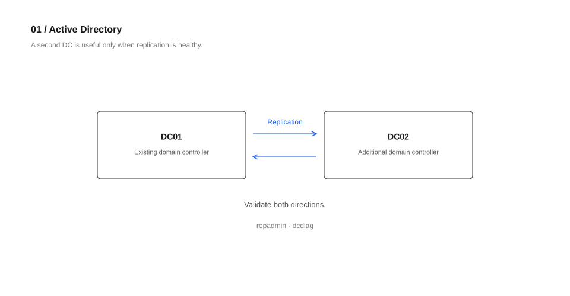
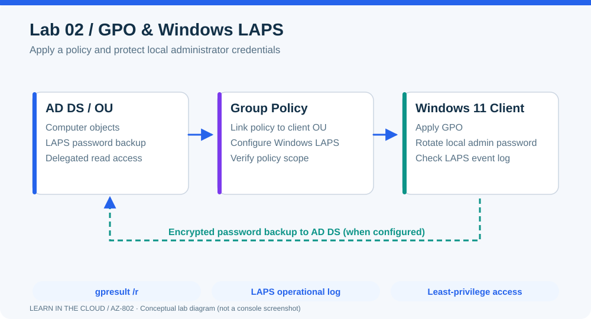
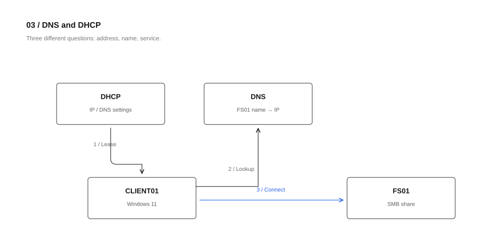
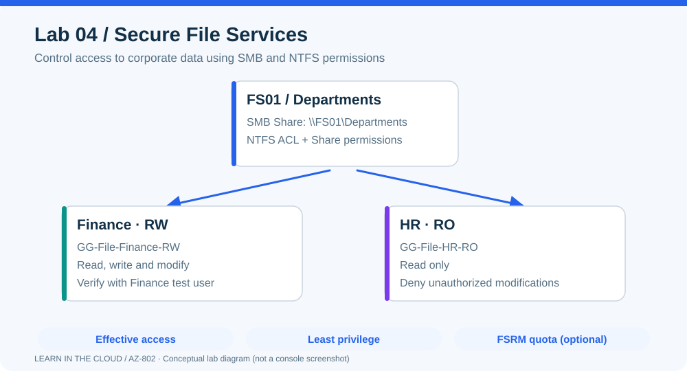
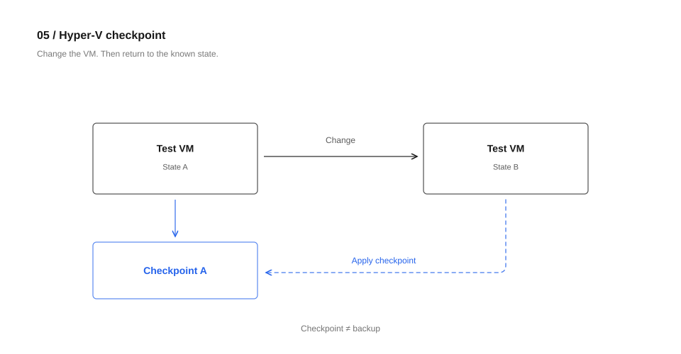
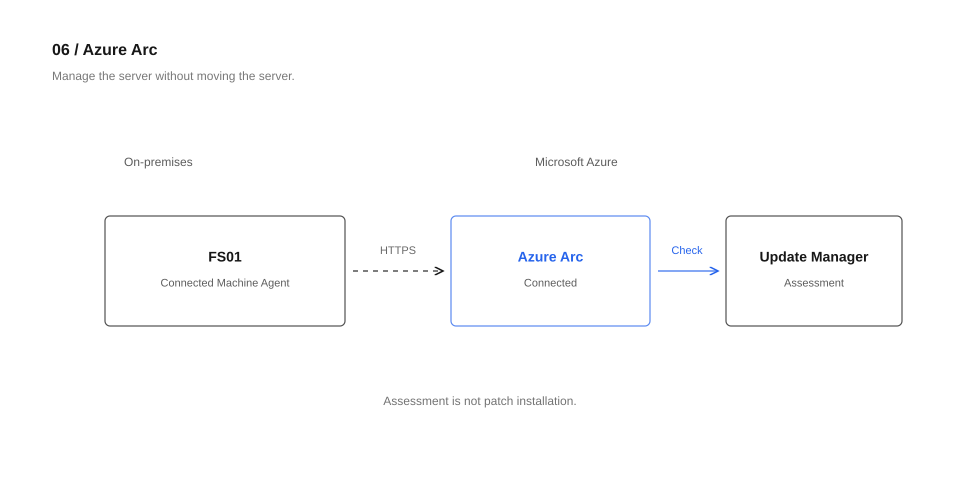
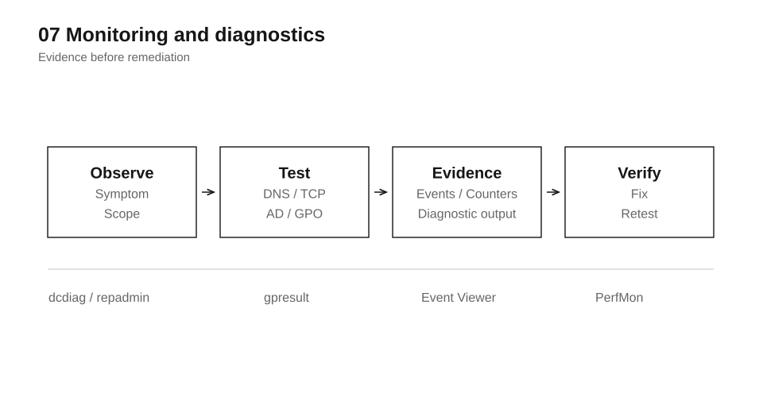
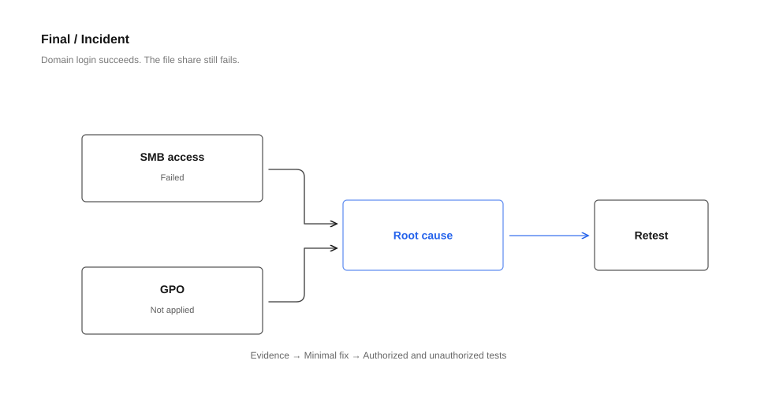

# AZ-802 — Administering Windows Server

**Learn in the Cloud | Windows Server 2025**

หลักสูตรสำหรับผู้ดูแล Windows Server ที่ต้องการฝึกตั้งแต่ Configure ไปจนถึง Validate และ Troubleshoot ในสภาพแวดล้อม On-premises และ Hybrid

**รูปแบบ:** Recorded Video (เรียนล่วงหน้า) + 2 Hands-on Tracks (Track ละ 1 วัน 09:00–17:00)

> Track 2 ยังเป็น **Course Design Proposal** ต้องทดลอง S2D/Cluster/QUIC และยืนยัน Lab Infrastructure ก่อนเปิดสอน

> Course Plan / Draft — เนื้อหาและ Lab อยู่ระหว่างพัฒนา ยังไม่ใช่เอกสารยืนยันวันเปิดอบรมหรือความพร้อมของวิดีโอทั้งหมด

## Hands-on Tracks

| Track | แนวทาง | Main Labs | ระยะเวลา |
|---|---|---|---|
| **Track 1 — Administration** | Deploy / Configure / Validate / Troubleshoot | AD DS, GPO/LAPS, DNS/DHCP, File Services, Azure Arc | 1 วัน |
| **Track 2 — Advanced Infrastructure** | Resilience / High Availability / Disaster Recovery | Failover Clustering, **S2D/CSV**, Node Failure, Hyper-V Live Migration, SMB over QUIC | **เป้าหมาย** 1 วัน (อยู่ระหว่างพัฒนา) |

Track 2 เป็น **Advanced Lab ที่แยกต่างหาก** ไม่ต้องลง Track 1 หากมีพื้นฐานเทียบเท่า และไม่ทำทุก Feature ขั้นสูงภายในหนึ่งวัน

อ่าน [รายละเอียด Track 2 — Advanced Infrastructure](docs/advanced-track.md)

## ภาพรวม Lab Environment

*ตัวอย่าง Architecture ที่ใช้ร่วมกันตลอด Workshop: Active Directory, File Server, Windows Client และ Azure Arc*

## รูปแบบการเรียน

**Recorded Video:** Concepts และ Demo ตาม Skills Measured ของ AZ-802 ทั้ง 7 Domains เพื่อเตรียมพื้นฐานก่อน Onsite

**Track 1 Onsite:** ทำ Project เดียวกันตลอดวัน ได้แก่ เพิ่ม Domain Controller, GPO/Windows LAPS, DNS/DHCP, File Services, Azure Arc, Monitoring และ Final Troubleshooting Challenge โดยมี Hyper-V เป็น Conditional Lab

ใช้ **Windows Server 2025** เป็น Lab Platform หลัก; หัวข้อสอบ AZ-802 ไม่ได้จำกัดเฉพาะ Windows Server 2025

## สิ่งที่จะได้ฝึกใน Track 1

- Deploy Additional Domain Controller และตรวจ Replication / FSMO / DNS
- Configure Group Policy และ Windows LAPS
- Configure DNS, DHCP และตรวจการทำงานจาก Windows Client
- Configure SMB Share และ Share/NTFS Permissions
- Connect On-premises Windows Server กับ Azure Arc และดู Update Assessment
- Monitor / Diagnose ด้วย Event Viewer, Performance Monitor และคำสั่ง Troubleshooting
- แก้ Incident จาก Requirements และหลักฐานที่ตรวจพบจริง

## Track 1 — Workshop Schedule

| เวลา | กิจกรรม |
|---|---|
| 09:00–09:20 | Requirements, Architecture, Lab Check |
| 09:20–10:10 | Lab 01 — Active Directory |
| 10:10–10:55 | Lab 02 — GPO & Windows LAPS |
| 10:55–11:40 | Lab 03 — DNS & DHCP |
| 11:40–12:00 | Validation & Q&A |
| 12:00–13:00 | Lunch |
| 13:00–14:10 | Lab 04 — File Services |
| 14:10–14:45 | Lab 05 — Hyper-V (Conditional) |
| 14:45–15:00 | Break |
| 15:00–15:45 | Lab 06 — Azure Arc & Update Manager |
| 15:45–16:20 | Lab 07 — Monitoring & Diagnostics |
| 16:20–17:00 | Final Troubleshooting Challenge |

Workshop เน้นให้ทำงานที่เลือกมาได้ **ครบและตรวจผลได้** ไม่ได้พยายามทำทุก Feature ใน Study Guide ภายในหนึ่งวัน

## ภาพประกอบ Lab

| | |
|---|---|
|  |  |
| 01 — Active Directory | 02 — GPO & Windows LAPS |
|  |  |
| 03 — DNS & DHCP | 04 — File Services |
|  |  |
| 05 — Hyper-V (Optional) | 06 — Azure Arc |
|  |  |
| 07 — Monitoring | Final Challenge |

ภาพประกอบใช้พื้นหลังขาว เส้นดำ และสีฟ้าเฉพาะจุดสำคัญ ตัวอักษร Segoe UI สูงสุด 16px และกรอบมุมมน 5px อ่านรายละเอียดโจทย์และวิธีตรวจผลใน [Lab Briefs](docs/lab-briefs.md) หรือดู [Visual Guidelines](docs/images/README.md)

## เอกสารหลักสูตร

- [Advanced Infrastructure Track](docs/advanced-track.md) — S2D, Cluster, CSV, Live Migration, SMB over QUIC และ Advanced Feature Backlog
- [Course Outline — Track 1](docs/course-outline.md) — กลุ่มเป้าหมาย, วัตถุประสงค์, Recorded Video Modules และ Mapping กับ AZ-802
- [Workshop Plan](docs/workshop-plan.md) — Project Scenario, ตารางเวลา, Priority และ Contingency Plan
- [Lab Briefs](docs/lab-briefs.md) — โจทย์, ขั้นตอนระดับงาน และ Validation ของ Lab 01–07 + Final Challenge
- [Instructor Setup](docs/instructor-setup.md) — Lab Topology, Prerequisites, Azure/Hyper-V Readiness และ Checklist เตรียมสอน

## Reference

[Microsoft Learn — Study guide for Exam AZ-802: Administering Windows Server](https://learn.microsoft.com/en-us/credentials/certifications/resources/study-guides/az-802)

AZ-802 เป็นชื่อและขอบเขตของการสอบ Microsoft; หลักสูตรนี้เป็น Course Plan ของ Learn in the Cloud ไม่ใช่หลักสูตรที่ Microsoft ออกแบบหรือรับรองโดยตรง
