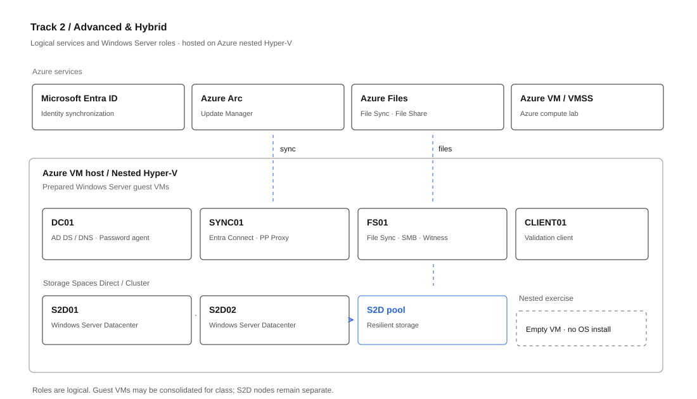
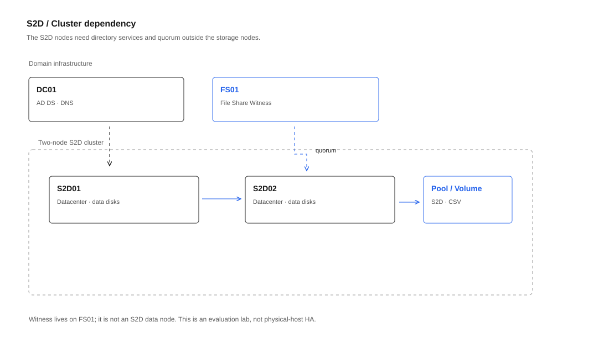

# Windows Server 2025 — Hands-on Project Workshop

**Learn in the Cloud | AZ-802: Administering Windows Server**

เรียน Concepts ผ่าน Recorded Video/Pre-work แล้วลงมือทำ Lab จากโจทย์ที่ใกล้เคียงงานจริงบน Windows Server 2025 และ Microsoft Azure

Workshop แบ่งเป็น **2 Tracks** เลือกเรียนแยกกันได้ Track ละ **1 วัน (09:00–17:00)**

> **สถานะ:** อยู่ระหว่างเตรียมเปิดรุ่นแรก กำหนดการและรายละเอียดการสมัครจะประกาศภายหลัง ราคาด้านล่างเป็นราคาที่เสนอสำหรับเปิดหลักสูตร ยังไม่เปิดรับชำระเงินผ่าน GitHub

## เลือก Track

| | Track 1 — Administration | Track 2 — Advanced & Hybrid |
|---|---|---|
| เหมาะกับ | IT Support, System Administrator | System Administrator, Infrastructure Engineer ที่มีพื้นฐานแล้ว |
| เน้น | Active Directory, Group Policy, Networking, File Services, Security, Troubleshooting | Azure Hybrid, Virtualization, Storage Spaces Direct, Azure Files, Hybrid Identity |
| AZ-802 Objectives | **01–05, 09–10, 12, 14, 16–18** (12 Objectives) | **06–08, 11, 13, 15** (6 Objectives) |
| Workshop | 1 วัน | 1 วัน |
| รายละเอียด | [Course Outline](docs/course-outline.md) | [Course Outline](docs/advanced-track.md) |

[ดู Selected Lab Catalog ทั้ง 18 Objectives](docs/lab-catalog.md)

### Track 1 — Administration

ฝึก Promote First DC, FSMO, AD Sites, Additional DC, Users/Groups, GPO, Windows Admin Center, DNS, DHCP Failover, SMB/FSRM/DFS, Hardening/Windows LAPS, Performance Monitoring และ Troubleshooting

[ดูตาราง Track 1](docs/workshop-plan.md) · [ดูหัวข้อ Lab](docs/lab-briefs.md)

### Track 2 — Advanced & Hybrid

ฝึก Azure Arc/Update Manager, Hyper-V/Nested Virtualization, Azure VM/VM Scale Set, Azure Files/File Sync, S2D และ Hybrid Identity (Entra Connect Sync, Entra Password Protection for AD DS, AD Hardening, Delegation)

**Lab Topology แสดง Logical Roles** เช่น DC01, FS01, SYNC01 และ S2D01/S2D02 เพื่อให้เข้าใจ Dependencies; ในห้องเรียนสามารถรวมบาง Roles ลง VM เดียวกันได้ตามความเหมาะสม

ใช้ Azure VM ขนาดใหญ่เป็น Nested Hyper-V Host โดยผู้สอนเตรียม Guest Images ล่วงหน้า บท S2D เน้น Create + Verify ส่วน Nested Hyper-V ทดลองสร้าง VM เปล่า ไม่ต้องติดตั้ง OS

[ดูตาราง Track 2](docs/advanced-track.md) · [ดู Logical Roles และ VM Mapping](docs/lab-topology.md)

## ค่าเรียน

| หลักสูตร | ระยะเวลา | ราคา |
|---|---|---:|
| Track 1 หรือ Track 2 | 1 วัน | 5,750 บาท |
| **Track 1 + Track 2** | 2 วัน | **10,500 บาท** |

กำหนดการ สถานที่ และรายละเอียดค่าใช้จ่ายอื่น ๆ จะแจ้งก่อนเปิดลงทะเบียน

[รายละเอียดหลักสูตรและคำถามที่พบบ่อย](docs/pricing-and-faq.md)

## เนื้อหา AZ-802 ที่คัดเลือก

หลักสูตรใช้ **18 Skill Objectives / 34 Activities** เป็นขอบเขตสำหรับ Recorded Video และ Labs ทั้งสอง Tracks โดยแยกงานที่ทำเองออกจาก Guided Labs ตามเวลาและ Prerequisites ที่ใช้

[รายละเอียดหัวข้อทั้ง 18 Objectives](docs/lab-catalog.md)

## วิธีเรียน

1. **Recorded Video / Pre-work:** Concepts, Prerequisites และ Demo ที่ใช้เวลานาน
2. **Onsite Workshop:** ลงมือ Configure Features ที่คัดเลือกไว้จากโจทย์ Project
3. **Validation:** ตรวจผลด้วย GUI, PowerShell และ Diagnostic Tools

Lab บางเรื่องเป็น Guided Exercise โดยเตรียม Images/Dependencies ไว้แล้ว ไม่ใช่การ Deploy ทุก Feature ตั้งแต่ศูนย์ภายในหนึ่งวัน

## เหมาะกับใคร

**Track 1:** มีพื้นฐาน Windows Server, IP/DNS และ PowerShell เบื้องต้น

**Track 2:** เข้าใจ AD DS, DNS, Storage และ Hyper-V อยู่แล้ว ไม่จำเป็นต้องเรียน Track 1 ก่อนถ้ามีพื้นฐานเทียบเท่า

## เอกสารหลักสูตร

- [Track 1 — Course Outline](docs/course-outline.md)
- [Track 1 — Workshop Schedule](docs/workshop-plan.md)
- [Track 1 — Lab Topics](docs/lab-briefs.md)
- [Track 2 — Advanced & Hybrid](docs/advanced-track.md)
- [All 18 Selected AZ-802 Lab Objectives](docs/lab-catalog.md)
- [Lab Topology and Logical Roles](docs/lab-topology.md)
- [Pricing & FAQ](docs/pricing-and-faq.md)

**Reference:** [Microsoft AZ-802 Study Guide](https://learn.microsoft.com/en-us/credentials/certifications/resources/study-guides/az-802)

หลักสูตรนี้พัฒนาโดย Learn in the Cloud ไม่ใช่หลักสูตรที่จัดหรือรับรองอย่างเป็นทางการโดย Microsoft การเรียน Workshop ไม่ได้รับประกันผลสอบ และ Workshop ไม่ได้ครอบคลุมทุก Feature ของ AZ-802 แบบ End-to-End
