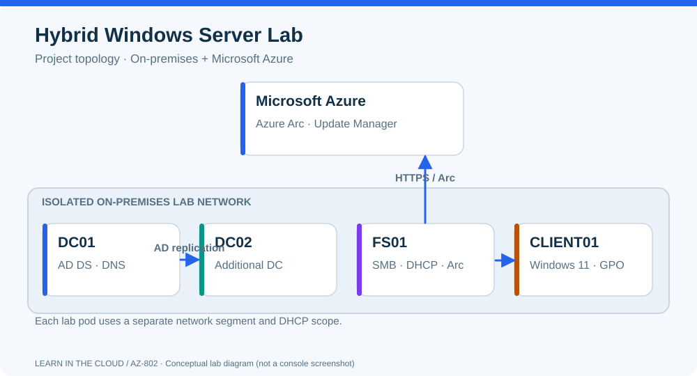

# Track 1 — Administration

**Windows Server 2025 | AZ-802 Hands-on Project Workshop**  
**Duration:** 1 วัน 09:00–17:00  
**ค่าเรียน:** 5,750 บาทต่อ Track หรือ 10,500 บาทสำหรับ 2 Tracks

## เป้าหมาย

สร้างและดูแลพื้นฐาน Windows Server Infrastructure โดยเน้น **Configure → Verify → Troubleshoot** ใช้ Images/Services ที่เตรียมไว้เพื่อให้เวลาวันอบรมเน้นการฝึกจริง

**Track 1 ครอบคลุม Objectives 01–05, 09–10, 12, 14, 16–18** ตาม [Selected AZ-802 Lab Catalog](lab-catalog.md)

## Lab Objectives

| # | Selected hands-on activities |
|---:|---|
| 01 | Promote First DC; manage FSMO |
| 02 | Configure AD Sites; add Additional DC |
| 03 | Create AD Users and Groups |
| 04 | Implement domain-based Group Policy |
| 05 | Install Windows Admin Center (WAC) |
| 09 | Configure DNS |
| 10 | Implement DHCP Failover |
| 12 | Configure Share Permissions; FSRM; DFS |
| 14 | Server Hardening; Windows LAPS |
| 16 | Performance Monitoring |
| 17 | Basic Connectivity, Name Resolution and Time Sync Troubleshooting |
| 18 | Enable AD Recycle Bin; Mini AD Health Check |

ใน 1 วันจะ **จัดเป็นหลาย Lab Sessions โดยรวม Tasks ที่สัมพันธ์กัน** และใช้ Staged Checkpoints กับ Guided Labs สำหรับหัวข้อที่มีการ Restart/Replication/Provisioning นาน ไม่รับประกันว่าทุก Activity จะเริ่มจาก OS เปล่าและจบเต็มกระบวนการ

## Recorded Video / Pre-work

เน้น AD DS, FSMO, Sites/Subnets, Groups, GPO, Windows Admin Center, DNS, DHCP Failover, File Services, Hardening, Windows LAPS, PerfMon และ Diagnostic Tools

[Track 1 Workshop Schedule](workshop-plan.md) · [Lab Topics](lab-briefs.md)

## Lab Environment

Logical Roles มี DC01, DC02, MGMT01, FS01, FS02 และ CLIENT01 แต่ **สามารถรวม Roles บางส่วนใน Lab ได้** ตาม [Topology and VM Mapping](lab-topology.md) โดยเฉพาะ WAC/Management และ File/DHCP Roles

## ความสัมพันธ์กับ AZ-802

เนื้อหาอ้างอิง [AZ-802 Study Guide](https://learn.microsoft.com/en-us/credentials/certifications/resources/study-guides/az-802) ของ Microsoft แต่คัด Tasks ที่เหมาะกับ Workshop และไม่ใช่หลักสูตรสอบอย่างเป็นทางการ

ต้องการ Advanced Hybrid, Azure VM, Nested Hyper-V, Azure Files, S2D หรือ Hybrid Identity ไปที่ [Track 2](advanced-track.md)
